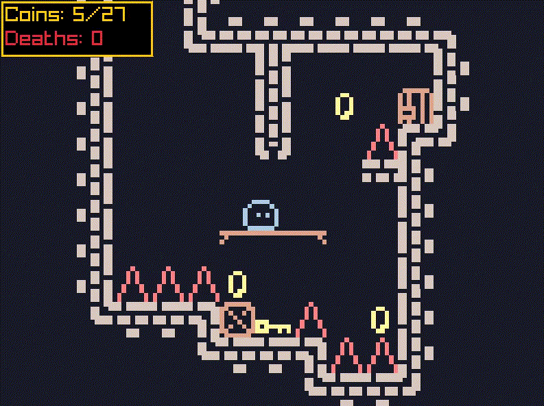
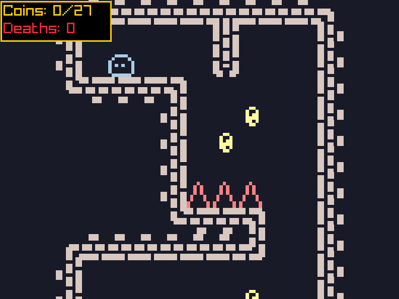
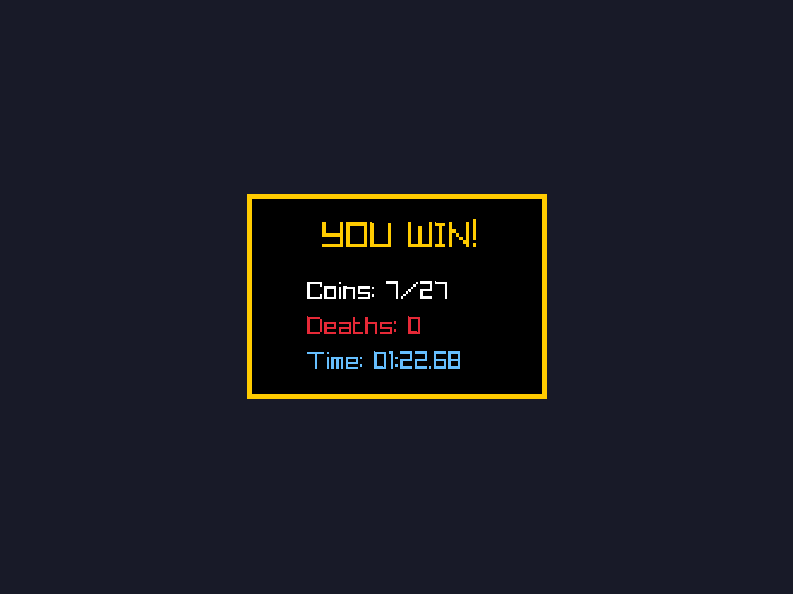

# 8-Bit Jump and Run MVP

A small pixel-art platformer built in C++ with raylib, used as a playground for trying out 2D game mechanics.



## Features

- Platforming with coyote time, walljumps and tight collisions
- Key & door system that links multiple rooms together
- Sprite animations for the player and coins
- Levels designed in [LDtk](https://ldtk.io)

## Screenshots

| Level | Finish screen |
|---|---|
|  |  |

## Controls

| Key | Action |
|---|---|
| A / D | Move left / right |
| Space | Jump / wall jump |

## Download

Get the latest build from the [Releases](../../releases) page.

## Building from source

Requires CMake ≥ 3.22 and a C++17 compiler. All dependencies are fetched automatically.

```bash
./run.bash        # build and run (Linux only)
./ship.bash       # release builds for Linux + Windows (needs mingw-w64-gcc)
```

Release binaries end up in `dist/`.

## Built with

- [raylib](https://www.raylib.com) – graphics & input
- [Dear ImGui](https://github.com/ocornut/imgui) + [rlImGui](https://github.com/raylib-extras/rlImGui) – debug UI
- [nlohmann/json](https://github.com/nlohmann/json) – LDtk level parsing
- [LDtk](https://ldtk.io) – level editor
